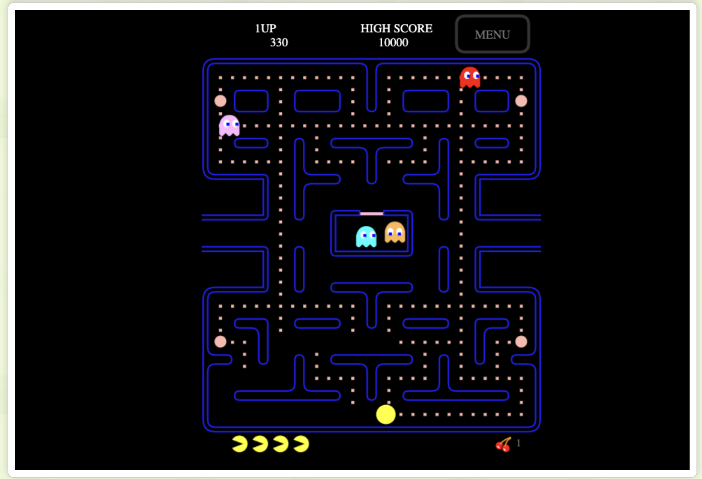

# Pac-Man

Pac-Man és un emblemàtic videojoc d'acció arcade desenvolupat per Namco i llançat l'any 1980. El jugador controla el personatge principal per un laberint, on ha de menjar-se tots els punts evitant ser capturat pels quatre fantasmes que el persegueixen.

---

## Enllaç per jugar online: 
https://pacmangratis.net/ 

 Imatge de captura del joc

---

- [Enllaç al document blinky.md](blinky.md)
- [Enllaç al document inky.md](inky.md)
- [Enllaç al document clyde.md](clyde.md)
- [Enllaç al document pinky.md](pinky.md)

---

**Autora:** [Paula](https://github.com/Paula-Pacho/pacman-git)
